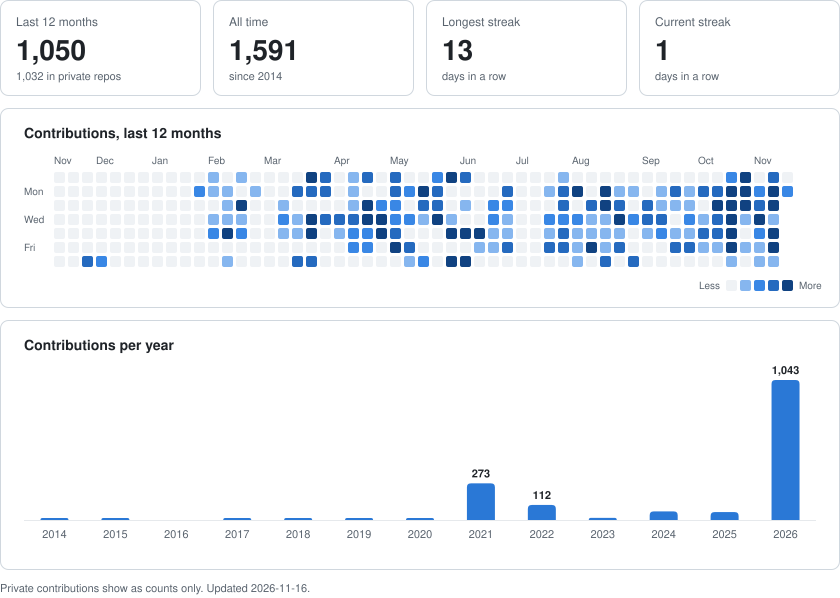

### Hi, I'm Marinos

Senior engineer at [TicketSwap](https://www.ticketswap.com), based in the Netherlands. More at [zagkotsis.com](https://zagkotsis.com).

<picture>
  <source media="(prefers-color-scheme: dark)" srcset="assets/dashboard-dark.svg">
  <source media="(prefers-color-scheme: light)" srcset="assets/dashboard-light.svg">
  
</picture>

Contributions per year as a table

<!-- yearly:start -->
| Year | Contributions | Private |
| --- | ---: | ---: |
| 2026 | 1,029 | 1,022 |
| 2025 | 59 | 57 |
| 2024 | 64 | 64 |
| 2023 | 16 | 16 |
| 2022 | 112 | 111 |
| 2021 | 273 | 272 |
| 2020 | 3 | 1 |
| 2019 | 3 | 0 |
| 2018 | 10 | 2 |
| 2017 | 2 | 0 |
| 2016 | 0 | 0 |
| 2015 | 4 | 0 |
| 2014 | 2 | 1 |
<!-- yearly:end -->

#### Public projects

- [theoros](https://github.com/marinoszago/theoros): plan and delegate complex tasks.
- [go-ddd](https://github.com/marinoszago/go-ddd): a Go web API with an import service, built with domain-driven design.
- [Fake-News-Detection](https://github.com/marinoszago/Fake-News-Detection): my master thesis, comparing deep learning and machine learning methods on short and long texts.
